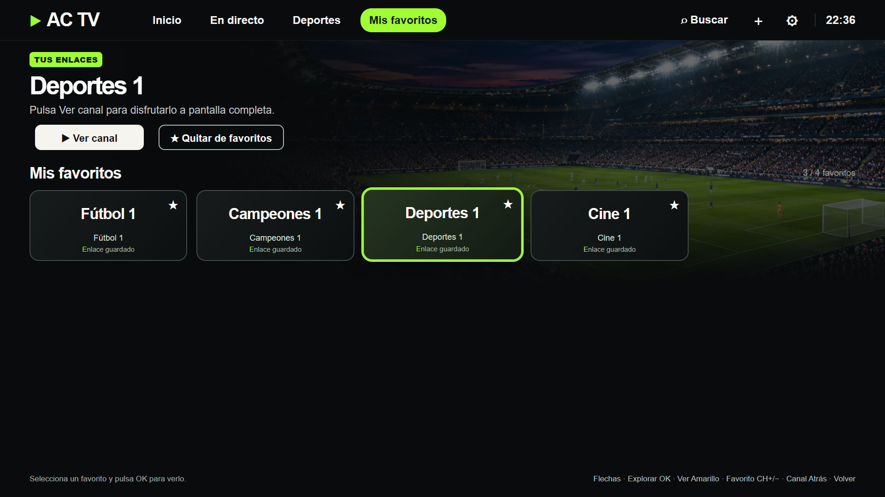
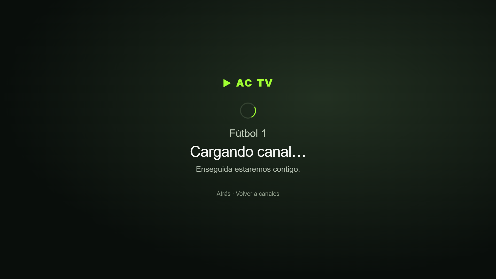
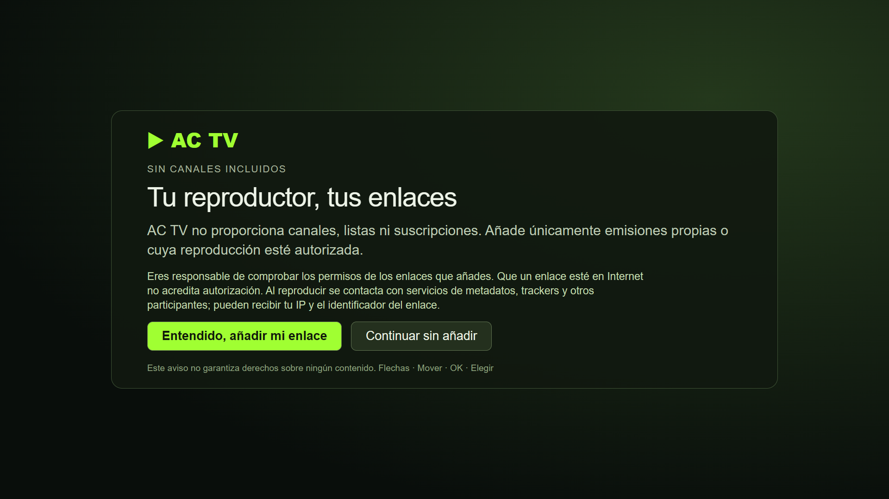
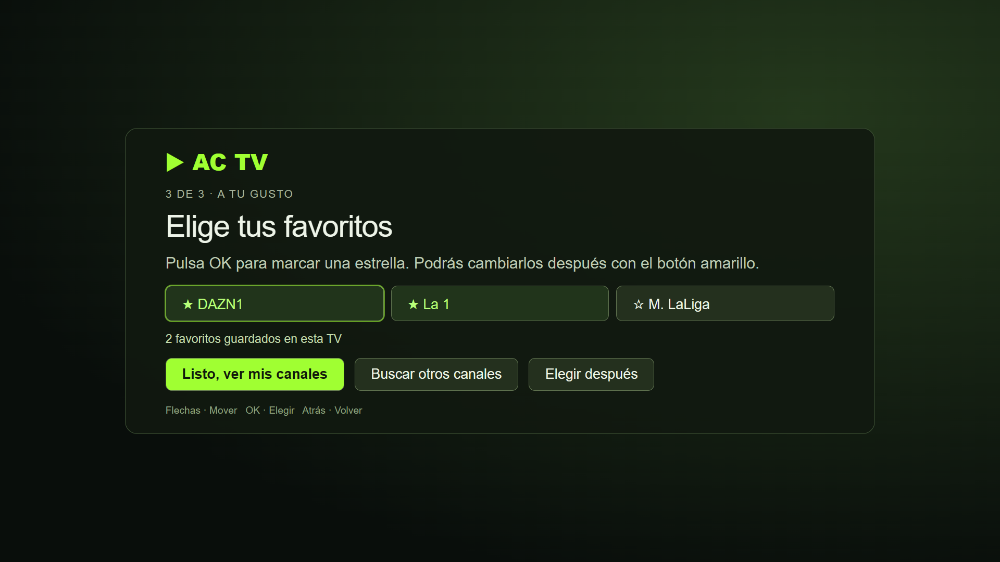

<p align="center">
  
</p>

<h1 align="center">AC TV para Samsung</h1>

<p align="center"><strong>Busca un canal. Guárdalo en favoritos. Dale al play desde el sofá.</strong></p>

<p align="center">Reproductor para Samsung Tizen con motor P2P integrado y vídeo nativo mediante AVPlay.<br>Una vez instalada, no necesitas mantener Ace Stream abierto en el ordenador.</p>

<p align="center">
  <a href="https://github.com/DANIRGZ1/ac-tv-samsung/actions/workflows/tests.yml"></a>
  
  
  <a href="LICENSE"></a>
</p>

<p align="center"><a href="#galería">Galería</a> · <a href="#instalar-en-tu-propia-tv">Instalación</a> · <a href="#tu-mando-es-suficiente">Controles</a> · <a href="#estado-y-compatibilidad">Compatibilidad</a> · <a href="CONTRIBUTING.md">Contribuir</a></p>

> **Experimental · Instalación en modo desarrollador.** Comprobada en un Samsung con Tizen 6.5. No está publicada en Samsung Apps; la compatibilidad con otros modelos aún debe verificarse.

## ¿Necesito una lista de canales?

**No es obligatorio aportar una lista propia.** En la versión actual puedes usar el catálogo público que descarga AC TV o abrir un enlace Ace Stream individual.

| Forma de usarla | Qué tienes que aportar |
| --- | --- |
| **Catálogo de la aplicación** | Conexión a Internet. En la bienvenida, pulsa **Preparar mis canales**; AC TV consulta el buscador público de Ace Stream y guarda los resultados en la TV. |
| **Enlace propio** | Un enlace `acestream://…` o un identificador compatible de 40 caracteres. Abre **Ajustes → Abrir un enlace**, pégalo y pulsa **Reproducir**. |
| **Lista M3U o URL de proveedor** | **Todavía no se puede importar directamente.** No es un requisito de instalación ni una función disponible en la versión 0.10.0. |

La instalación añade el reproductor y su motor. El catálogo se obtiene después desde Internet; no hay una lista personal de canales incluida en el paquete. Que un canal aparezca en el catálogo no garantiza que esté emitiendo o que su enlace funcione.

Para reproducir desde la Samsung no necesitas mantener Ace Stream abierto en el ordenador. El ordenador se usa para firmar e instalar la app; la opción de importar un catálogo desde el PC es un respaldo opcional.

## Tu televisión, a tu manera

AC TV reúne el catálogo, tus favoritos y el reproductor en una interfaz pensada para una pantalla grande. Busca por nombre, explora categorías y elige con las flechas del mando. La conexión se gestiona por dentro: mientras abre la emisión, solo ves el nombre del canal y «Cargando canal…».

| Función | Qué te aporta |
| --- | --- |
| **Motor en la propia Samsung** | Reproducción P2P con AVPlay sin mantener un motor abierto en el PC. |
| **Favoritos a un toque** | Tus canales a mano; añade o quita favoritos con el botón amarillo, también mientras ves uno. |
| **Búsqueda por nombre** | Busca en el catálogo guardado en la TV, con coincidencias flexibles de nombres y marcas. |
| **Una interfaz para el mando** | Tarjetas grandes, foco redondeado, animación suave y categorías. |
| **Logos guardados en la app** | 59 variantes locales; nombre legible si no existe una correspondencia exacta. |
| **Carga y recuperación sencillas** | Cancelación con Atrás, reintentos automáticos y opciones claras si el canal falla. |

## Galería

### Una portada con tus favoritos


<table>
<tr>
<td width="50%"><strong>Explora los canales</strong><br><br></td>
<td width="50%"><strong>Tus favoritos, juntos</strong><br><br></td>
</tr>
<tr>
<td width="50%"><strong>Encuentra el canal por su nombre</strong><br><br></td>
<td width="50%"><strong>Elige y deja que cargue</strong><br><br></td>
</tr>
</table>

[Ver todas las capturas a tamaño completo →](docs/GALLERY.md)

*Interfaz real renderizada en Chromium con datos sintéticos. La portada es una composición gráfica de esa interfaz; las capturas no son fotografías de una TV ni una prueba de disponibilidad de las emisiones. No muestran listas personales ni identificadores reales de contenido del usuario.*

## Primer arranque guiado

Al abrir una instalación vacía, AC TV te da la bienvenida, prepara el catálogo y te deja marcar tus primeros favoritos con OK. Puedes cancelar, reintentar o elegirlos después. Las instalaciones con canales guardados conservan sus datos y no muestran esta guía automáticamente. Puedes volver a abrirla desde **Ajustes → Guía de inicio**.





## Tu mando es suficiente

| Botón | Acción |
| --- | --- |
| **Flechas** | Recorrer tarjetas, secciones y categorías. |
| **OK** | Elegir un canal; durante el vídeo, pausar o reanudar. |
| **Amarillo** | Añadir o quitar el canal de favoritos. |
| **CH+ / CH−** | Cambiar de canal. |
| **Atrás** | Cancelar la carga o volver al catálogo durante la reproducción. |

## Estado y compatibilidad

**0.10.0 · Samsung UE50BU8500KXXC · Tizen 6.5 / Chromium 85.** El encuadre, la reproducción nativa, los logos y el control con mando se comprobaron en ese equipo. Otros televisores y versiones de Tizen no están verificados.

El catálogo y los favoritos se guardan en la TV. El refresco consulta el buscador público de Ace Stream; ese servicio puede cambiar. La disponibilidad y la calidad de cada emisión dependen de sus fuentes. No se distribuye una lista personal de canales ni enlaces de contenido. AC TV es un proyecto independiente y no está afiliado con Samsung, Ace Stream ni las cadenas.

## Instalar en tu propia TV

Sigue la [guía paso a paso](docs/INSTALL.md). El nuevo ayudante comprueba las herramientas sin conectarse a la TV; solo firma e instala cuando añades `-Install`.

```powershell
# Comprobar primero, sin modificar la TV:
pwsh -File scripts/install-tv.ps1 -TvIp 192.168.1.42 -SecurityProfile MiPerfilTV
# Firmar con tu perfil e instalar:
pwsh -File scripts/install-tv.ps1 -TvIp 192.168.1.42 -SecurityProfile MiPerfilTV -Install -Launch
```

### Empaquetado manual

Necesitas Tizen Studio, Samsung TV Extension, Samsung Certificate Extension y un perfil de firma propio que incluya el dispositivo de destino. Activa el modo desarrollador de la TV y conéctala con las herramientas del SDK.

```powershell
# Con los runtimes precompilados incluidos:
pwsh -File work/build-native-app.ps1
# Firma con TU perfil; no se incluyen certificados:
tizen package -t wgt -s TU_PERFIL -o work -- work/acetv-native-app
# Selecciona tu TV y usa el instalador de Tizen Studio o la CLI:
tizen install -n AceTV.wgt -t NOMBRE_DE_TU_TV -- work
```

El nombre del WGT firmado puede variar según la CLI: usa el archivo que indique `tizen package`. La instalación en otra TV requiere su certificado de distribuidor; el WGT de un desarrollador no es un instalador universal.

Documentación oficial: [CLI de Samsung](https://developer.samsung.com/smarttv/develop/getting-started/using-sdk/command-line-interface.html) y [pruebas de aplicaciones](https://developer.samsung.com/smarttv/develop/faq/application-testing.html).

## Pruebas

Node.js 22 o posterior:

```sh
npm test
npm install
# Requiere Google Chrome instalado para las pruebas visuales.
npm run test:ui
```

Las pruebas cubren búsqueda, catálogo local/directo, persistencia de favoritos, errores de almacenamiento, selección, cancelación, reintentos, pausa, congelación, callbacks antiguos, encuadre y flujo de carga. Las pruebas de navegador usan datos sintéticos y no necesitan conexiones P2P.

## Código y motor

- `work/acetv-native-app`: interfaz, catálogo, favoritos y adaptador AVPlay.
- `work/acetv-wire-wasm`: receptor de protocolo en Rust compilado a WebAssembly.
- `work/acetv-live-probe/src`: puente Worker, sockets y servidor HTTP de bucle local.
- `work/outpace-research`: fuentes upstream de Outpace conservadas para la licencia y para reconstruir el motor.
- `work/build-wire-probe.ps1`, `work/build-live-probe.ps1`: reconstrucción de componentes. Requieren Rust nightly-2026-03-15, wasm-bindgen 0.2.105 y el SDK WebAssembly de Samsung compatible con sockets Tizen. El SDK y los certificados no se redistribuyen.

Los runtimes generados incluidos permiten empaquetar la aplicación sin recompilar Rust ni el puente Samsung. Consulta [arquitectura y compilación](docs/BUILD.md).

## Licencias y recursos

Código AC TV y componentes de Outpace: **AGPL-3.0-or-later**; consulta [LICENSE](LICENSE), los avisos `NOTICE.txt` y las licencias upstream. Outpace: [jamezrin/outpace](https://github.com/jamezrin/outpace), revisión `dba774d870e08d2778748196e145455c74f22152`.

Los logos identifican a sus respectivas cadenas y pertenecen a sus titulares; no implican afiliación. Se obtuvieron de [tv-logo/tv-logos](https://github.com/tv-logo/tv-logos); procedencia individual en `work/acetv-native-app/assets/logos/SOURCES.json`. No se presentan como creación propia ni como recursos licenciados bajo AGPL. Fondos de estadio y categorías generados para este proyecto; descripción en [recursos visuales](docs/ASSETS.md).


## ¿Quieres ayudar?

Si lo pruebas en otro modelo, [abre una incidencia](https://github.com/DANIRGZ1/ac-tv-samsung/issues/new) indicando modelo, versión de Tizen, comportamiento esperado y lo que ocurrió. También son bienvenidas mejoras de interfaz, accesibilidad y documentación. Consulta [CONTRIBUTING.md](CONTRIBUTING.md).

<details>
<summary><strong>English overview</strong></summary>

AC TV is an experimental Samsung Tizen TV player with an integrated TV-local P2P engine, native AVPlay playback, remote-friendly navigation, favorites, channel search and bundled channel logos. Playback does not require keeping Ace Stream running on a PC after installation. Tested on one Samsung Tizen 6.5 television; other models are unverified. Developer-mode installation and your own Samsung signing certificates are required. Source code is available under AGPL-3.0-or-later. Screenshots use synthetic demonstration data.

</details>
