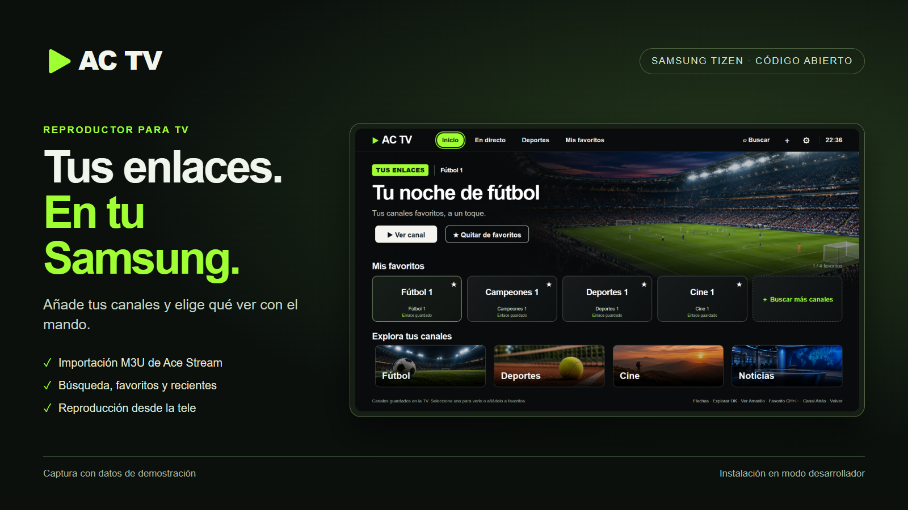
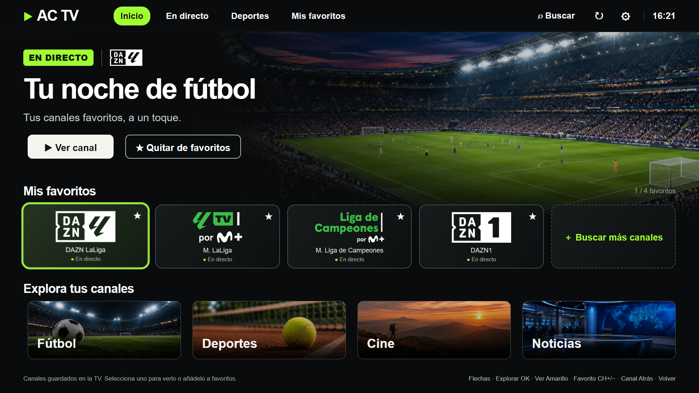
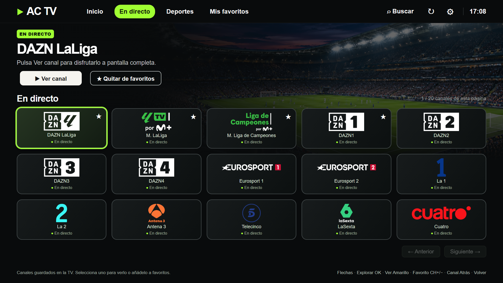
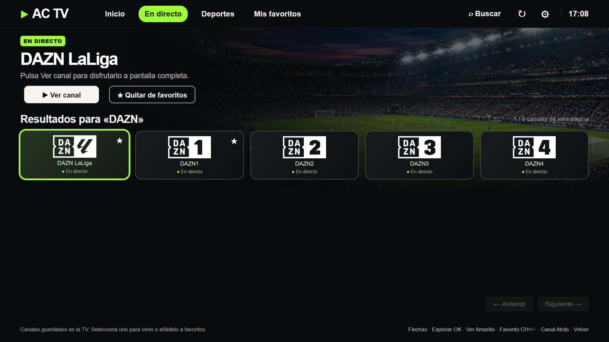
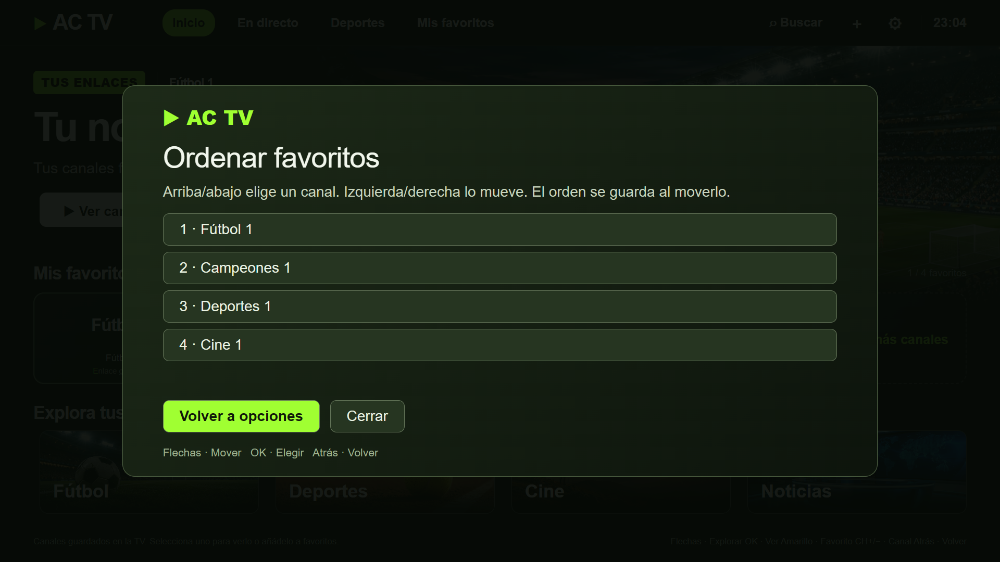
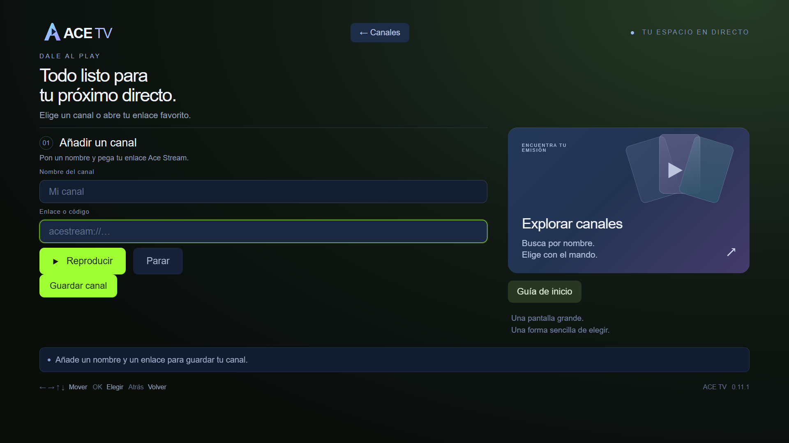

<h1 align="center">AC TV para Samsung</h1>

<strong>Tus enlaces, tus favoritos y el mando de tu Samsung.</strong>

Reproductor experimental de enlaces Ace Stream para Samsung Tizen. Una vez instalado, el motor integrado reproduce desde la tele con AVPlay.

  
  
  

<a href="#instalación">Instalación</a> · <a href="#galería">Galería</a> · <a href="#preguntas-frecuentes">Preguntas frecuentes</a> · <a href="docs/COMPATIBILITY.md">Compatibilidad y ayuda</a>

> **Instalación en modo desarrollador.** AC TV se instala desde este repositorio con el SDK y un perfil de firma de Samsung. Al abrirla por primera vez, la biblioteca está vacía.

## Qué puedes hacer

| Añade tus enlaces | Encuentra lo que guardaste | Reproduce con el mando |
| --- | --- | --- |
| Guarda un enlace o importa varios desde una lista M3U de Ace Stream. Puedes cambiar el nombre o el enlace más tarde. | Busca por nombre, ordena tus favoritos y vuelve a los últimos 12 canales reproducidos. | Navega con las flechas, abre con **OK** y cambia de canal con **CH+/CH−**. |

La app guarda la biblioteca y recuerda tu última selección en la tele. [Ver la guía de canales y favoritos](docs/LIBRARY.md)

## Instalación

1. **Prepara la TV y el ordenador.** Activa el modo desarrollador, conecta ambos a la misma red y prepara un perfil de firma Samsung válido para tu televisor.
2. **Comprueba la conexión e instala.** El instalador separa el diagnóstico con `-Diagnose` de la firma e instalación.
3. **Crea tu biblioteca.** En la TV, abre **Ajustes** para añadir un canal o importar una lista M3U de enlaces Ace Stream.

| Elige cómo instalar | |
| --- | --- |
| **Con Codex** | [Tutorial con instrucciones para copiar](docs/INSTALL_WITH_CODEX.md) |
| **Con Claude Code** | [Tutorial desde el ordenador de tu red local](docs/INSTALL_WITH_CLAUDE.md) |
| **Manual** | [Requisitos, diagnóstico y comandos](docs/INSTALL.md) |

## Galería

<table>
  <tr>
    <td width="50%"><strong>Explora tus canales</strong> </td>
    <td width="50%"><strong>Busca por nombre</strong> </td>
  </tr>
  <tr>
    <td><strong>Ordena tus favoritos</strong> </td>
    <td><strong>Añade tu propio enlace</strong> </td>
  </tr>
</table>

*Capturas de escritorio con datos ficticios. «Fútbol1» y «Campeones1» son ejemplos de interfaz.* [Ver todas las pantallas](docs/GALLERY.md)

## Preguntas frecuentes

**¿Está en la tienda Samsung?** La instalación pública se hace en modo desarrollador. [Ver la guía](docs/INSTALL.md)

**¿Tengo que dejar el PC encendido?** El ordenador se usa para instalar. El motor de reproducción funciona en la TV.

**¿Qué listas M3U admite?** Puedes pegar el texto o seleccionar un archivo `.m3u` o `.m3u8`. Se añaden las entradas Ace Stream compatibles, se omiten los duplicados y los enlaces IPTV o HLS genéricos, y se conservan tus favoritos. [Cómo importar una lista](docs/LIBRARY.md#importar-una-lista-m3u)

**¿Qué modelos están comprobados?** Instalamos la versión pública 0.13.0 y probamos la importación M3U en una Samsung BU8500 de 2022. [Consultar compatibilidad o compartir una prueba](docs/COMPATIBILITY.md)

## Uso responsable y código

Añade únicamente contenido cuya reproducción y, cuando corresponda, redistribución estén autorizadas. Tú eres responsable de los enlaces que utilizas. Al reproducir, el motor puede consultar metadatos, DNS, trackers y pares. P2P puede compartir tu dirección IP y el identificador del enlace con terceros. [Uso responsable](docs/RESPONSIBLE_USE.md)

AC TV es un proyecto independiente publicado bajo AGPL-3.0-or-later. [Licencia](LICENSE) · [Compilación](docs/BUILD.md) · [Cómo contribuir](CONTRIBUTING.md)

| Si buscas… | Dónde mirar |
| --- | --- |
| Cambios entre versiones | [Historial](CHANGELOG.md) |
| Ayuda con la instalación, M3U o el mando | [Solución de problemas](docs/TROUBLESHOOTING.md) |
| Cómo reportar un fallo de seguridad | [Política de seguridad](SECURITY.md) |
