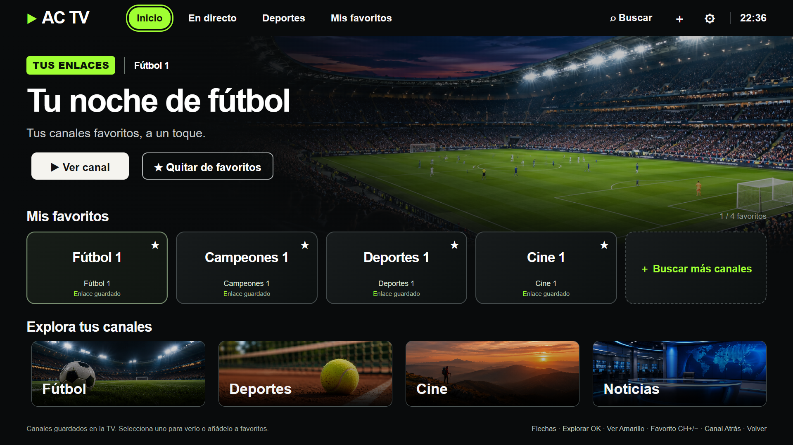
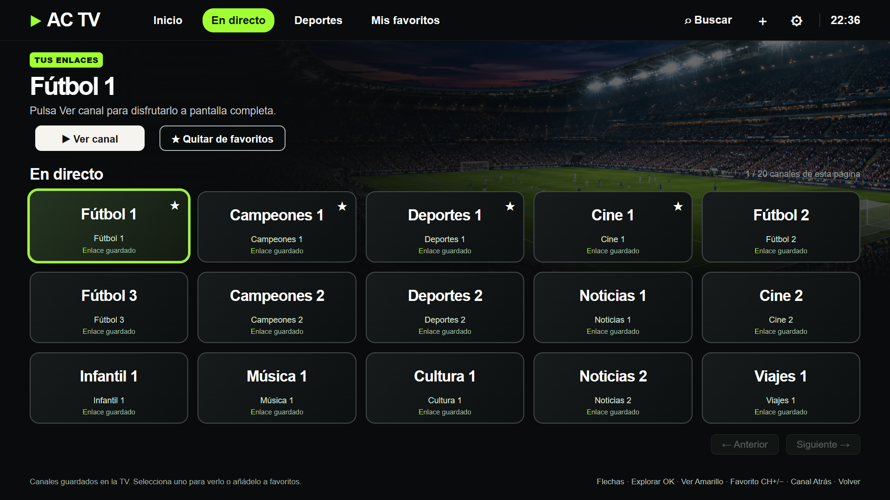
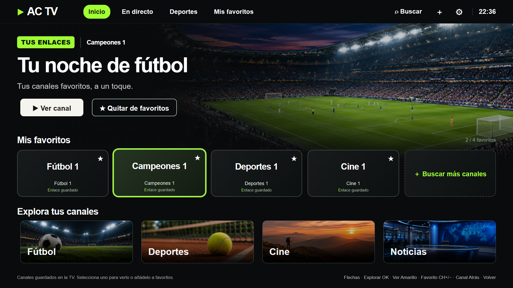
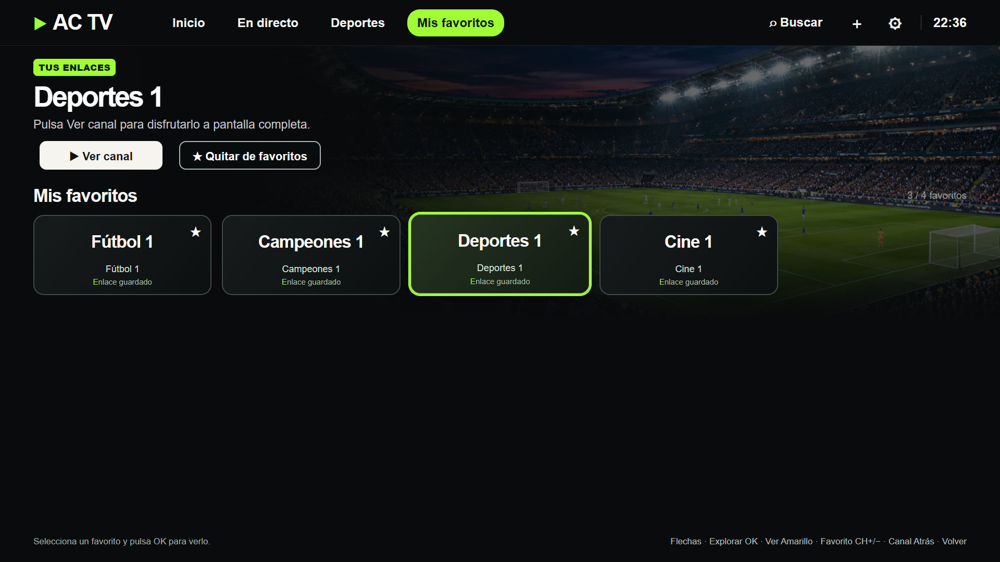
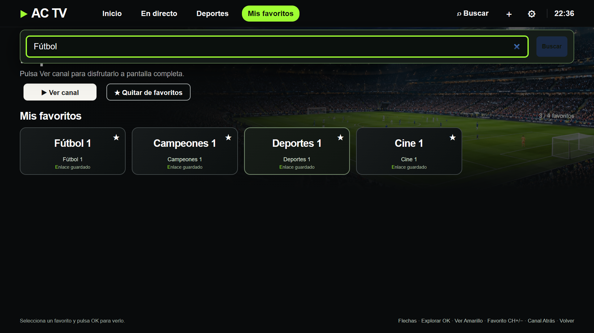
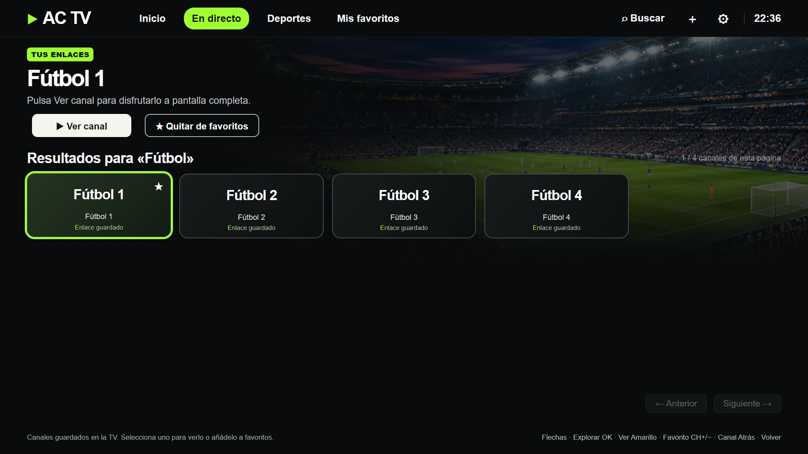
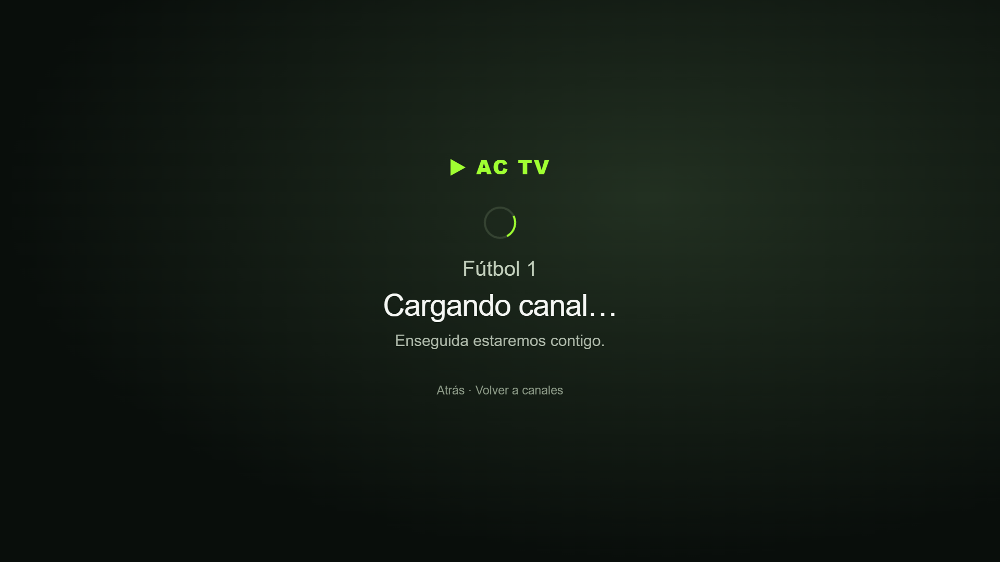
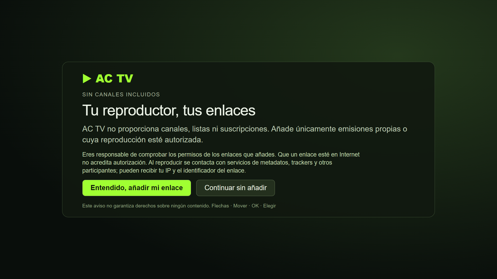
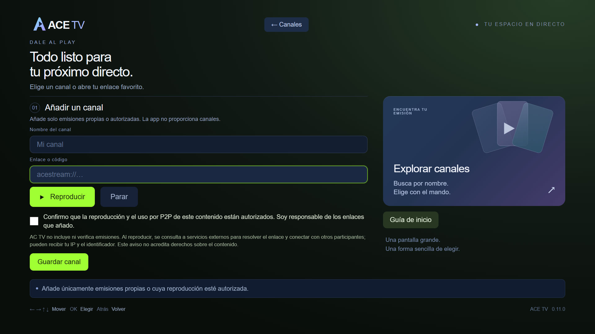

# AC TV en imágenes

Capturas de la interfaz renderizada en escritorio con datos sintéticos. No son fotografías de una TV ni evidencias de disponibilidad de emisiones. Los nombres “Fútbol1” y “Campeones1” son ficticios y los identificadores son sintéticos y no funcionales.

## Inicio

## Canales de demostración

## Selección

## Favoritos

## Búsqueda

## Resultados

## Carga

Las imágenes que muestran canales usan nombres genéricos. No contienen logos de canales reales ni material promocional de TV de pago. La galería no representa un catálogo incluido: la versión pública empieza vacía.

## Primer uso y enlaces propios

La bienvenida informa de que no se incluyen canales y explica la responsabilidad del usuario.

El formulario permite guardar un enlace propio con un nombre. No contiene enlaces precargados.

