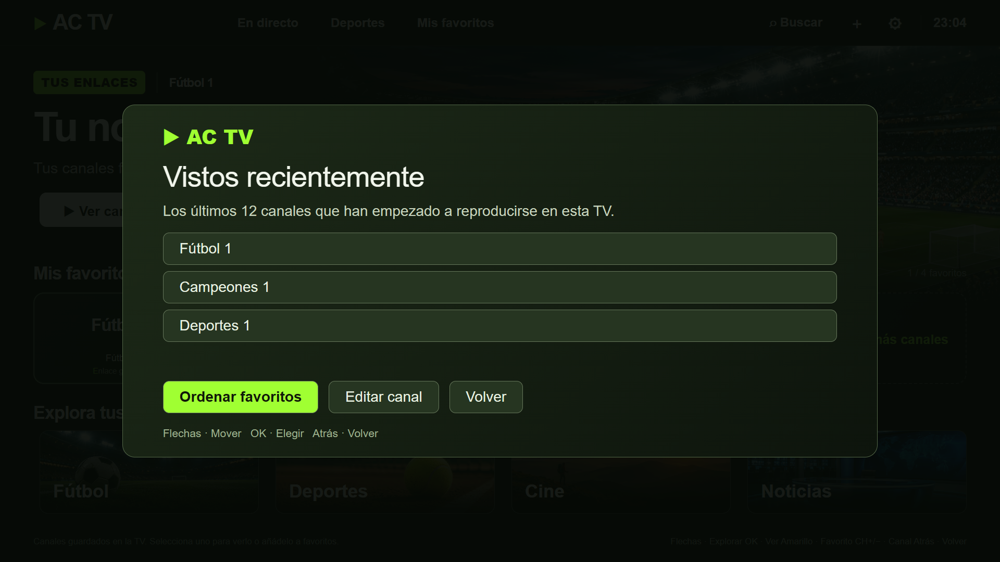
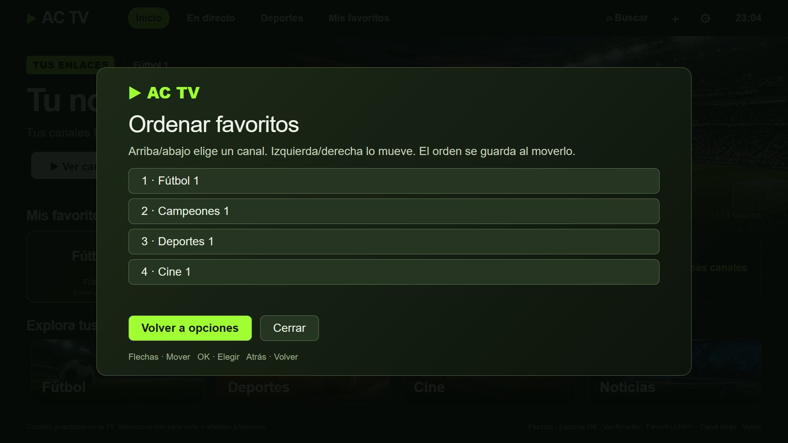
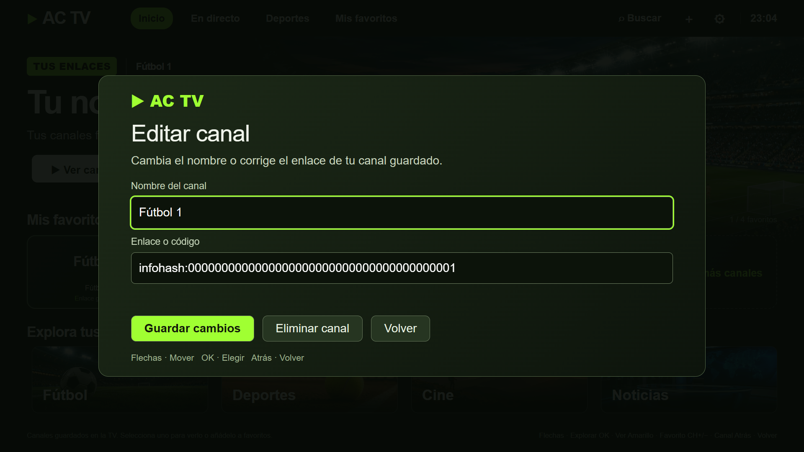

# Tus canales y favoritos

Abre **Opciones**, junto a Ver canal y Añadir a favoritos. Funciona con las flechas, OK y Atrás.

## Importar una lista M3U

1. Ve a **Ajustes → Importar lista M3U**.
2. Selecciona un archivo local `.m3u` o `.m3u8` si la TV ofrece el selector, o pega el texto de la lista.
3. Revisa la vista previa y confirma **Importar**. Los canales nuevos se añaden al final de tu biblioteca. Los nombres de los canales que ya tienes, sus favoritos y su historial se conservan.

Se admiten listas de hasta 2 MiB con enlaces Ace Stream compatibles. El importador recoge el nombre y el grupo cuando están indicados, y omite las entradas no compatibles, como las URL genéricas de IPTV y HLS. Puedes ver el recuento de entradas omitidas antes de guardar. La biblioteca admite hasta 5000 canales.

El archivo se lee en la TV y se importa como una copia local. Los cambios posteriores en el archivo requieren volver a importarlo. [Uso responsable](RESPONSIBLE_USE.md)

## Recientes

Muestra hasta 12 canales después de que empiece la reproducción. Un enlace que falla al cargar no se añade. Pulsa OK sobre un reciente para abrirlo. Pausar y reanudar no crea duplicados. El historial permanece en esta TV.

## Ordenar favoritos

En Opciones, elige Ordenar favoritos. Usa arriba y abajo para elegir el canal, e izquierda y derecha para moverlo una posición. Cada movimiento se guarda. Atrás sale de esta pantalla; no deshace los movimientos ya guardados. La lista general de canales conserva su orden.

## Editar o eliminar un canal

Selecciona primero la tarjeta del canal, entra en Opciones y pulsa Editar canal. Puedes modificar su nombre o sustituir el enlace compatible. Guardar cambios actualiza también su entrada en favoritos y recientes. Si el nombre está vacío, el enlace es inválido o pertenece a otro canal guardado, no se aplica el cambio.

Eliminar canal muestra una confirmación con **Cancelar** seleccionado inicialmente. Solo al confirmar se quita el canal y sus entradas en favoritos y recientes. El resto de canales permanece. Es una eliminación local, no un bloqueo permanente en un proveedor que puedas importar de nuevo.

## Al volver a abrir

AC TV recuerda la sección, la página y la tarjeta seleccionada. Si ese canal ya no existe, selecciona una tarjeta disponible. Al arrancar de nuevo muestra la biblioteca. Si regresas a una sesión que seguía abierta, puede recuperar el canal que estaba en reproducción o cargando.

Los cambios de canal/favoritos/recientes se guardan con una copia de recuperación local para restaurar un cambio interrumpido al abrir la aplicación. Si falla el almacenamiento, la app informa del problema en lugar de dar por guardado el cambio.

Todas las imágenes usan nombres ficticios e identificadores sintéticos. No representan emisiones reales ni un catálogo incluido.

## Enlaces alternativos y canal anterior

- Guarda los enlaces del mismo canal con el mismo nombre. AC TV agrupa sus tarjetas y favoritos e ignora diferencias de mayúsculas, tildes y espacios repetidos. Usa nombres distintos para emisiones que quieras mantener separadas.
- En la tarjeta, abre **Opciones → Enlaces del canal**. **Hacer principal** guarda la fuente principal. **Se abre con OK** identifica la última fuente que funcionó o la principal si aún no hay una fuente recordada. **Ver ahora** abre solo el enlace elegido. Si falla la apertura, **Probar otro enlace** permite pasar al siguiente.
- El **botón azul** vuelve al canal anterior durante la sesión y permite alternar cuando ambos canales han empezado a reproducirse. También funciona con la tecla **Canal anterior** si el mando la ofrece. Pulsa **Atrás** para recuperar la tarjeta del canal.

## Comprobar la aplicación

En **Biblioteca → Comprobar la aplicación** puedes consultar la versión, la disponibilidad local de red, los recuentos de biblioteca y el estado del reproductor. **Actualizar** vuelve a comprobarlos y **Copiar informe** permite compartir el texto para pedir ayuda. El informe no incluye nombres de canales, enlaces, identificadores de contenido ni direcciones IP. La disponibilidad de red no confirma por sí sola que Internet funcione.

Durante la carga está disponible **Volver a canales**. Si el vídeo deja de avanzar, el reproductor nativo puede intentar reconectar hasta tres veces. Una pausa voluntaria no inicia esta recuperación.

Al abrir un canal, una línea discreta muestra etapas reales como «Buscando conexiones P2P…» o «Probando conexión 3 de 12…». El contador corresponde a intentos sobre candidatos, no al número de espectadores ni a conexiones simultáneas. No se muestran IPs y la línea desaparece al empezar el vídeo.

## Recuperación de reproducción y biblioteca

Si falla una fuente en la TV, AC TV puede probar automáticamente un enlace alternativo guardado para el mismo canal. Solo prueba una alternativa por intento de reproducción. Puedes pulsar **Atrás** para cancelar o elegir una fuente desde **Enlaces del canal**. Al regresar a la aplicación, puede volver a abrir el canal si estaba reproduciéndose o cargando al salir. Una pausa voluntaria no inicia la reproducción automática.

La primera apertura tras una actualización guarda una copia local de los canales, favoritos, recientes y fuentes recordadas. En **Biblioteca → Copia de actualización** puedes restaurarla. La restauración conserva los datos actuales en la copia para que puedas deshacerla desde el mismo menú.
